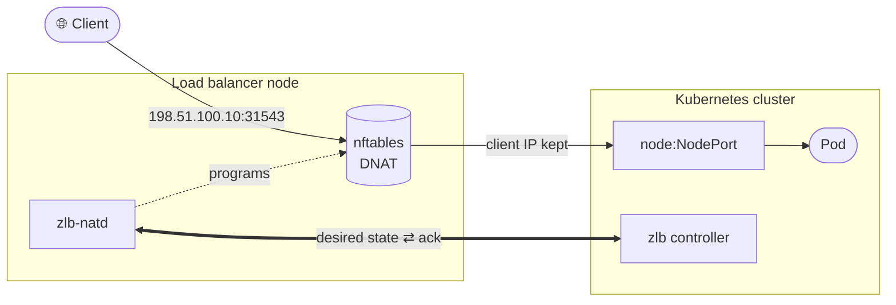

<div align="center">

# zlb

**Public IPs for Kubernetes `LoadBalancer` Services, served from any Linux machine.**

[](https://github.com/abexamir/zlb/actions/workflows/ci.yml)
[](https://github.com/abexamir/zlb/actions/workflows/publish.yml)
[](LICENSE)


No cloud load balancer, BGP or layer 2 for your nodes? Put the public IPs on one Linux
machine and let zlb turn your Services into kernel DNAT rules there.

</div>



## Why zlb

| | MetalLB · Cilium with LB IPAM | **zlb** |
| --- | --- | --- |
| Who holds the public IP | cluster nodes, announced over L2 or BGP | **one external Linux machine** |
| Network requirement | L2 adjacency or a BGP peer | **routing to that machine** |
| Clients connect to | `IP:servicePort` | `IP:nodePort`, or literal ports you reserve |
| Many Services per IP | opt-in sharing | **by default** |
| Trade-off | announcement speakers on nodes | one NAT hop, one extra machine, no HA |

[Cilium LB IPAM](https://docs.cilium.io/en/stable/network/lb-ipam/) allocates addresses;
Cilium's separate L2 Announcements or BGP Control Plane advertises them. Prefer MetalLB or
Cilium when your network allows them; choose zlb when only a separate machine can own the
addresses. Let exactly one implementation handle unclassified LoadBalancer Services.

## Features

| | |
| --- | --- |
| 🌐 **IP pools** | static IPv4 pools with optional per-pool Service allowlists; IPs are added to the machine for you |
| 🔌 **Ports** | Services share IPs on their NodePorts; reserve literal ports (80/443) or a whole IP |
| 📦 **Traffic** | TCP, UDP, SCTP · `Local` and `Cluster` policy · `loadBalancerSourceRanges` · client IPs preserved |
| 🛡️ **Safe changes** | `nft --check`, atomic commit, readback, rollback; forwarding survives crashes and upgrades |
| 🏷️ **Visible** | status, Events and a `published-ports` annotation on every Service |
| 🔐 **Secure** | TLS/mTLS API, sandboxed non-root daemon, controller confined by an admission policy |
| ⚙️ **Hands-off** | optional SSH bootstrap installs and upgrades the daemon from Helm |
| ⚡ **Fast** | one map lookup per packet; re-sending an unchanged state costs milliseconds |

```text
Service port 5432, NodePort 31543   →  198.51.100.10:31543
Reserved ingress ports 80 and 443   →  198.51.100.10:80, 198.51.100.10:443
```

## Quick start

**1 · Prepare a VM** that the public IPs route to and that can reach your nodes' NodePorts.

**2 · Create the API token** and a values file from
[examples/helm-values.yaml](examples/helm-values.yaml):

```sh
kubectl create namespace zlb-system
kubectl -n zlb-system create secret generic zlb-lb-node-token \
  --from-literal=token="$(openssl rand -hex 32)"
```

**3 · Install.** With `bootstrap.enabled`, Helm also installs the daemon on the VM over SSH.

```sh
helm upgrade --install zlb oci://ghcr.io/abexamir/charts/zlb --version 0.3.0 \
  -n zlb-system -f values.yaml --wait --timeout 15m
```

**4 · Expose** any Service with `type: LoadBalancer`. The [operator guide](docs/guide.md#install)
has the full walkthrough.

## Documentation

| | |
| --- | --- |
| 📘 [Operator guide](docs/guide.md) | install, security, networking, configuration, operations, troubleshooting |
| 🔧 [Internals](docs/internals.md) | reconcile loop, wire format, generated rules, packet path, failures |
| ⎈ [Chart](charts/zlb/README.md) · [Examples](examples/README.md) | chart and upgrade notes, sample inputs |
| 🤝 [Contributing](CONTRIBUTING.md) | development, tests, releases |

## Security

Report vulnerabilities privately through
[GitHub private vulnerability reporting](https://github.com/abexamir/zlb/security/advisories/new),
never in public issues. Hardening (TLS/mTLS, `--allow-from`, the root-equivalent SSH
bootstrap key) is covered in [securing the load balancer node](docs/guide.md#secure-the-load-balancer-node).

**Scope:** IPv4 on Linux with nftables; one controller per load balancer node. No IPv6,
load balancer node HA, health probes or Prometheus metrics; in-cluster clients reach public
IPs only with the opt-in hairpin SNAT. Apache-2.0.
