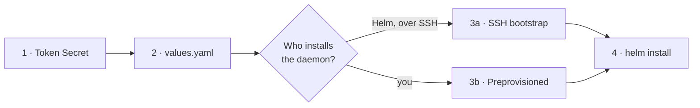
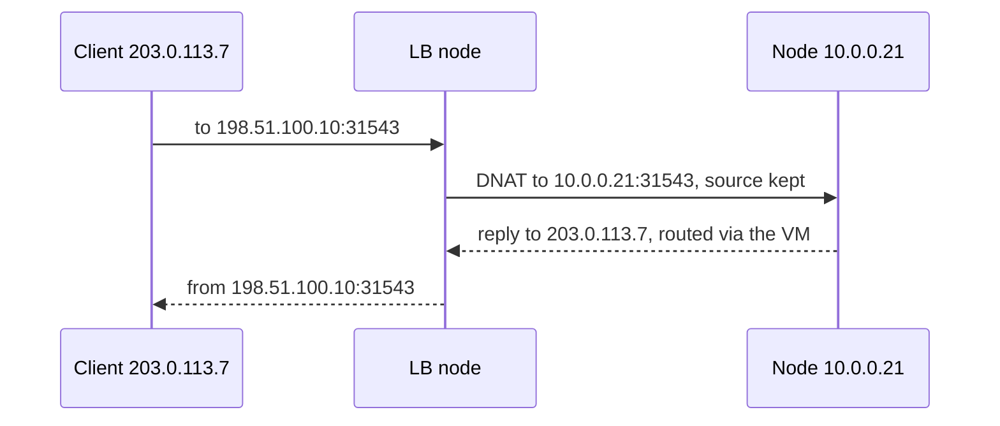

# zlb operator guide

Install, secure, configure, operate and troubleshoot zlb. How it works inside:
[internals](internals.md).

Examples use this documentation topology; substitute your own:

| Item | Example |
| --- | --- |
| Load balancer node (VM) | `10.0.0.3`, daemon API on `:9808` |
| Public interface, public IP | `eth0`, `198.51.100.10` |
| Node CIDR | `10.0.0.0/24` |

- [Requirements](#requirements)
- [Install](#install)
- [Secure the load balancer node](#secure-the-load-balancer-node)
- [Networking](#networking)
- [Configure pools and Services](#configure-pools-and-services)
- [Command-line flags](#command-line-flags)
- [Operate](#operate)
- [Troubleshoot](#troubleshoot)

## Requirements

The **load balancer node** is a Linux VM outside the cluster. The public IPs must route to
it, it must reach node InternalIPs and NodePorts, and replies must come back through it.

| Component | Requirement | Tested |
| --- | --- | --- |
| Kubernetes | 1.21+ (discovery/v1). 1.30+ adds `ipMode: Proxy` and the `rbac.restrictServiceWrites` admission policy | CI: 1.34, 1.37 (kind e2e) · manual: 1.29, 1.34 |
| Helm | 3.19+ or Helm 4 | CI: 3.19 |
| Load balancer node | Linux, IPv4 forwarding, nftables, iproute2, Python 3.11+, systemd | CI: Debian 13 · manual: Ubuntu 24.04 |
| SSH bootstrap target | Debian 12+ or Ubuntu 24.04+ | CI: Debian 13 · manual: Ubuntu 24.04 |

A kernel or nftables build missing a feature zlb needs is caught by `nft --check` before any
change. SCTP also needs SCTP conntrack/NAT in the VM's kernel and in your CNI.

## Install



### 1. Token

```sh
kubectl create namespace zlb-system
kubectl -n zlb-system create secret generic zlb-lb-node-token \
  --from-literal=token="$(openssl rand -hex 32)"
```

The daemon requires at least 32 characters. SSH bootstrap copies the token to the VM; for a
preprovisioned daemon put the same value in `/etc/zlb/token`.

### 2. Values

Copy [examples/helm-values.yaml](../examples/helm-values.yaml) and set `lbNode.url` (with
port), `nodeCIDR` and [`pools`](#pools).

### 3a. SSH bootstrap

Helm installs and upgrades the daemon on one explicit VM:

```yaml
bootstrap:
  enabled: true
  existingSecret: zlb-ssh
  sshHost: 10.0.0.3          # IPv4 literal
  sshUser: root              # others need passwordless sudo
  publicInterface: eth0
  publicIPs: [198.51.100.10/32]
```

```sh
kubectl -n zlb-system create secret generic zlb-ssh \
  --from-file=private_key=./id_ed25519 --from-file=known_hosts=./known_hosts
```

| | |
| --- | --- |
| Runs as | `pre-install`, `pre-upgrade`, `pre-rollback` hook Job; optional drift-repair CronJob (`bootstrap.schedule`) |
| Installs | Python if missing, nftables, iproute2, the `zlb-natd` user, package, token, TLS files, unit; enables IPv4 forwarding |
| Idempotent | unchanged installs are untouched; a token-only change is written without a restart |
| On failure | restores the previous daemon without interrupting forwarding ([details](internals.md#ssh-bootstrap)) and fails the Helm operation |
| Logs | the Job shows only the exit code (255 = SSH failed); details are in `journalctl -u zlb-natd` on the VM |
| Isolation | the SSH key is root-equivalent on the VM; only the bootstrap pods mount it, and they have no Kubernetes API token |

Host keys are never trusted on first use, and `lbNode.url` must be `http(s)://IPv4:PORT` on
that VM. Creating the VM, routing and firewall stay with your infrastructure tooling.

### 3b. Preprovisioned daemon

Install Python 3.11+, nftables and iproute2, copy the `zlb/` package to `/opt/zlb/zlb`, and
follow the header of [the example unit](../examples/systemd/zlb-natd.service) (user, token
`root:zlb-natd` 0640, forwarding, enable). `ExecStopPost` needs `--listen` plus the same
`--ip`, `--public-interface`, `--node-cidr`, `--table` and `--state-dir` as `ExecStart`.
Keep `/var/lib/zlb` persistent.

### 4. Helm

```sh
helm upgrade --install zlb oci://ghcr.io/abexamir/charts/zlb --version 0.3.0 \
  -n zlb-system -f values.yaml --wait --timeout 15m
```

The timeout covers package installation on the VM. The chart runs a single replica with
`Recreate`: two controllers must never drive one daemon. Ready means the daemon acknowledged
a tick; test your published ports from outside.

## Secure the load balancer node

### Daemon API

The bearer token travels with every request; use HTTPS unless the path is fully private.

| Daemon flag | Chart value | Effect |
| --- | --- | --- |
| `--tls-cert`, `--tls-key` | `bootstrap.tlsSecret` (`tls.crt`, `tls.key`) | TLS 1.2+; needs an IP SAN for the `lbNode.url` host |
| `--tls-client-ca` | `ca.crt` in that Secret + `bootstrap.requireClientCertificates` | require client certificates from this CA |
| `--allow-from CIDR` | `bootstrap.apiAllowFrom` | drop other peers before reading |
| `--max-connections` (16) | | concurrent connections; 30 s per request |
| `--backend-port-range` | `bootstrap.backendPortRange` (`30000-32767`) | a stolen token cannot publish SSH, kubelet or etcd |

| Controller value | Purpose |
| --- | --- |
| `lbNode.caConfigMap` (`ca.crt`) | CA that signed the daemon certificate |
| `lbNode.clientCertSecret` (`kubernetes.io/tls`) | controller client certificate for mTLS |
| `lbNode.allowPrivateHTTP: true` | required for plain HTTP |

```yaml
lbNode:
  url: https://10.0.0.3:9808
  existingSecret: zlb-lb-node-token
  caConfigMap: zlb-lb-node-ca
  clientCertSecret: zlb-controller-client
bootstrap:
  tlsSecret: zlb-lb-node-tls
  requireClientCertificates: true
  apiAllowFrom: [10.0.0.0/24]
```

### Host protection

| Option | Default | Effect |
| --- | --- | --- |
| Forward guard | on | drops new connections from `--public-interface` that were not DNATed, so the VM is not an open router; disable with `--allow-foreign-forwarding` (`bootstrap.allowForeignForwarding`) |
| `--isolate-public-ips` (`bootstrap.isolatePublicIPs`) | off | public IPs answer only listeners, replies and ping; local services such as sshd stop answering there |

### Firewall baseline

zlb owns only `table ip zlb`; the rest of the firewall is yours.

- Listener traffic is **forwarded**, never input. Every forward chain with a drop policy
  (yours, firewalld, ufw, Docker) must accept DNATed traffic to the node CIDR and replies.
- Open the API port only to the controller's sources, SSH only to admins.
- Never load a ruleset with `flush ruleset`: it deletes zlb's table until the next tick.

```nft
table inet site_filter {
  chain input {
    type filter hook input priority 0; policy drop;
    ct state established,related accept
    iif lo accept
    icmp type echo-request accept
    ip saddr 192.0.2.0/24 tcp dport 22 accept
    ip saddr 10.0.0.0/24 tcp dport 9808 accept
  }
  chain forward {
    type filter hook forward priority 0; policy drop;
    ct state established,related accept
    ct status dnat ip daddr 10.0.0.0/24 accept
  }
}
```

## Networking



| Topic | What to know |
| --- | --- |
| Return path | The client source is preserved, so node replies must route back through the VM. With a separate egress router, add return routing ([example](internals.md#return-routing-example)). |
| Client address | `externalTrafficPolicy: Cluster` may SNAT on the node; use `Local` to keep the client IP. |
| Hairpin | In-cluster clients calling a public IP get the reply straight from the backend and drop it. `--hairpin-snat-from CIDR` (`bootstrap.hairpinSnatFrom`: the node CIDR, plus the Pod CIDR if your CNI does not SNAT Pod egress) masquerades only connections from those sources to a zlb listener's (IP, protocol, port). External clients, your own DNAT and `loadBalancerSourceRanges` still see the original source. The VM cannot test its own public IPs. |
| Protocols | TCP, UDP and SCTP may share a port number. SCTP needs kernel and CNI support (e.g. [Cilium](https://docs.cilium.io/en/stable/configuration/sctp/)); multihoming is not claimed. |

### Optional LB routes

zlb can manage explicit IPv4 routes in the load balancer node's main routing table.
For a dedicated VM with a public uplink and a separate management network:

```yaml
bootstrap:
  routes:
    - destination: 10.0.0.0/8
      interface: eth1
      gateway: 10.0.0.1
    - destination: 0.0.0.0/0
      interface: eth0
      gateway: 198.51.100.1
```

Management return routes are installed before the public default. Declare every private
network needed for SSH and API replies; the public default changes the VM's ordinary
internet egress too. Gateway routes use `onlink`, supporting public IPs assigned as /32s.
The daemon needs no extra privilege beyond its existing `CAP_NET_ADMIN`.

This is opt-in: `bootstrap.routes: []` leaves an unclaimed routing table alone. zlb
journals each changed destination and its previous route, verifies readback, and repairs
drift on reconciliation. Removing a configured route or cleanly stopping the daemon
restores its previous route; a matching preexisting route is never claimed or deleted.
Connected kernel routes, multipath routes and multiple routes for one managed destination
are refused. Keep the state directory persistent. Preprovisioned daemons accept repeated
`--route` JSON objects with `destination`, `interface` and optional `gateway`.

These settings configure only the LB itself. A separate router must still send inbound
replies through it; zlb never configures another machine's routing or firewall.

## Configure pools and Services

### Pools

The controller re-reads its pool JSON (`pools` in the chart) every tick; an invalid file
fails the tick and keeps the last accepted rules.

```json
{
  "default_pool": "public",
  "blocked_ports": [9808],
  "pools": [
    {"name": "public", "ips": ["198.51.100.10"],
     "reservations": [{"ip": "198.51.100.10", "ports": [80, 443], "service": "ingress/ingress"}]},
    {"name": "dedicated", "ips": ["198.51.100.11"], "services": ["apps/mail"],
     "reservations": [{"ip": "198.51.100.11", "service": "apps/mail"}]}
  ]
}
```

| Field | Meaning |
| --- | --- |
| `pools[].name` | unique lowercase DNS label |
| `pools[].ips` | explicit IPv4 addresses; no CIDRs, no overlap between pools |
| `pools[].services` | optional `namespace/name` allowlist; omitted allows all, `[]` allows none |
| `pools[].reservations` | literal `ports` (numbers or `[first, last]`) for one Service, or no `ports` for the whole IP; held while the owner is absent |
| `default_pool` | pool for Services without `zlb.zarrino.tech/pool` |
| `blocked_ports` | never published, literal or NodePort (default `[9808]`) |

**IP choice**, first match wins, never spilling into another pool:

1. the `zlb.zarrino.tech/ip` annotation (must be eligible, or the Service fails);
2. the Service's current IP;
3. an IP reserved to the Service;
4. the lowest pool IP not wholly reserved to another Service.

**Collisions.** If two Services resolve to the same `(IP, protocol, port)`, the reservation
owner wins, else the older Service. The loser fails whole and alone with a Warning Event;
so does a Service that collides with itself or exceeds the daemon's `/v1/info` limits.
Keep reserved ports outside the NodePort range.

### Services

Any `type: LoadBalancer` Service without a class is adopted, as is
`spec.loadBalancerClass: zlb.zarrino.tech/gateway`; other classes are ignored.

```yaml
apiVersion: v1
kind: Service
metadata:
  name: database
  namespace: apps
spec:
  type: LoadBalancer
  externalTrafficPolicy: Local
  selector:
    app: database
  ports:
    - name: tcp
      port: 5432
```

| Aspect | Behaviour |
| --- | --- |
| Published port | the NodePort for unreserved ports (e.g. `198.51.100.10:31543`), the Service port for reserved ones |
| `zlb.zarrino.tech/published-ports` | written after the daemon accepts, e.g. `5432:31543/TCP`; removed on rejection |
| Annotations you set | `zlb.zarrino.tech/pool`, `zlb.zarrino.tech/ip`; `spec.loadBalancerIP` is rejected |
| `Cluster` backends | Ready nodes with an InternalIP in the node CIDR, not deleting, not labelled `node.kubernetes.io/exclude-from-external-load-balancers` |
| `Local` backends | those nodes with ready, non-terminating endpoints |
| NodePorts | always required; keep `allocateLoadBalancerNodePorts` enabled |
| `loadBalancerSourceRanges` | enforced on the VM; established connections survive changes (no conntrack flush) |

## Command-line flags

The chart sets these; `--help` lists all of them.

**Controller** (`python3 -m zlb.controller`):

| Flag | Meaning |
| --- | --- |
| `--lb-node URL` | daemon API with port; HTTP also needs `--allow-private-http` |
| `--token-file` | bearer token, re-read per request |
| `--ca-file`, `--client-cert`, `--client-key` | HTTPS trust and mTLS |
| `--pool-config FILE` or repeated `--ip` | pools, or one pool named `default` |
| `--node-cidr` | node InternalIPs; must lie inside the daemon's |
| `--interval` (5) | seconds between ticks, ±10 % jitter |
| `--resync` (600) | seconds between full relists, minimum 30 |
| `--ready-file` | written after each successful tick |

**Daemon** (`python3 -m zlb.natd`):

| Flag | Meaning |
| --- | --- |
| `--listen`, `--port` (9808), `--token-file` | API address and token |
| `--ip ADDR[/PREFIX]` (repeat) | allowed public IPs, added to the interface (default `/32`) |
| `--public-interface`, `--node-cidr` | where public IPs live; allowed backends |
| `--backend-port-range` (30000-32767) | allowed backend ports |
| `--reserved-port` (repeat) | never published; the API port always is |
| `--table` (zlb), `--state-dir` (/var/lib/zlb) | owned table and address journal |
| `--cleanup` | remove the owned table and addresses, then exit |

The daemon journals the addresses it adds and only ever removes those; preexisting and
primary addresses survive. Changing the interface or an owned prefix needs a cleanup with
the old settings first; never delete the journal.

## Operate

### Observe

| Where | Command | Look for |
| --- | --- | --- |
| Controller | `kubectl -n zlb-system logs deploy/zlb-controller` | `reconciled services= listeners= errors=`; `service=ns/name error=`; `reconcile failed` |
| Service | `kubectl -n apps get events --field-selector involvedObject.name=database` | `LoadBalancerSyncFailed` (at most every 5 min per error) |
| Daemon | `journalctl -u zlb-natd` | `applied revision=`; `rejected desired state`; `ROLLBACK FAILED` (act now); `rejected API connection` |
| Rules | `nft list map ip zlb dispatch` | `IP . protocol . port : jump l_<id>` |
| Traffic | `nft list counters table ip zlb` | `c_<id>`: new connections per listener |
| API | `curl https://10.0.0.3:9808/healthz`, `/v1/info` (with token) | liveness; accepted wire versions, IPs, CIDR, ports |

The controller is Ready while a tick succeeded in the last 30 seconds. There are no
Prometheus metrics.

### Verify a Service

```sh
kubectl -n apps get svc database -o jsonpath='{.status.loadBalancer.ingress[0].ip} {.metadata.annotations.zlb\.zarrino\.tech/published-ports}'
curl --connect-timeout 3 http://198.51.100.10:31543/   # from outside the cluster and the VM
```

Check the client address the application sees. Verify removal with a new connection;
existing ones may finish.

### Change pools or addresses

| Change | Order |
| --- | --- |
| Add an IP | route it to the VM → add it to the daemon (`bootstrap.publicIPs` or `--ip`) → add it to a pool |
| Remove an IP | remove it from the pool → wait for an acknowledged tick → remove it from the daemon |

A Helm pool change restarts the controller; a mounted pool file is re-read each tick (mount a
directory, not a `subPath`).

### Restart and upgrade

The unit's cleanup runs after every stop. It keeps forwarding after a crash or when the
one-shot keep marker exists, and removes everything otherwise:

```sh
sudo touch /run/zlb/zlb.keep && sudo systemctl restart zlb-natd.service
```

After a VM reboot the daemon re-adds its addresses and the next tick restores the rules.

**Upgrade the daemon before the controller.** 0.5.0 controllers send wire version 3, which
older daemons reject (old rules keep serving; the controller stays not Ready).

| Daemon install | Upgrade |
| --- | --- |
| SSH bootstrap | `helm upgrade` (already in the right order) |
| Preprovisioned | new package in `/opt/zlb/zlb` → update the unit → `daemon-reload` → keep-marker restart → `helm upgrade` |
| Preprovisioned, from 0.4.0 | first create the `zlb-natd` user and make `/etc/zlb/token` `root:zlb-natd` 0640 |

Rolling back to chart 0.2.0 reinstalls the 0.4.0 daemon, whose restart drops forwarding
until the next push. Per-release notes: [chart README](../charts/zlb/README.md#upgrade-notes).

### Tokens

Both sides re-read the token per request. Update the Secret and `/etc/zlb/token` together
(bootstrap does it without a restart); expect brief 401s in between.

### Capacity

| Measure | Value |
| --- | --- |
| Wire limits | 4096 listeners, 2 MiB request ([details](internals.md#wire-format-and-http-api)) |
| Changed snapshot apply | ~6 s at 600 listeners × 100 nodes; ~29 s at 2000 × 100 (nft timeout 30 s) |
| Unchanged re-send | milliseconds at any size |
| Controller memory, 20,000 EndpointSlices | ~22 MiB (limit 128Mi) |

Cost scales with listeners × backend nodes; `Local` policy and the exclusion label keep it
down. Size `nf_conntrack_max` on the VM for peak concurrent connections.

### Uninstall

Delete or convert your LoadBalancer Services first and wait for their
`zlb.zarrino.tech/cleanup` finalizers to go. Then:

```sh
helm uninstall zlb -n zlb-system --wait
ssh root@10.0.0.3 systemctl disable --now zlb-natd.service   # removes table and addresses
```

Outside systemd, run `python3 -m zlb.natd --cleanup` from `/opt/zlb` with the serving flags
(the keep marker blocks it). If the VM is gone for good, make sure nothing forwards before
removing zlb's finalizers by hand.

## Troubleshoot

Follow the packet:


| Symptom | Check |
| --- | --- |
| Service stays pending | Its Warning Event; class, pool allowlist, requested IP, whole-IP reservations, blocked ports, `allocateLoadBalancerNodePorts`; controller log for pool JSON, RBAC, token, TLS or a node-CIDR mismatch |
| Controller not Ready | `reconcile failed`: daemon unreachable, 401, TLS, 400 from an older daemon, a failed Service write |
| Daemon won't start or answers 400 | `journalctl -u zlb-natd`: forwarding off, token under 32 characters, missing interface, address on another interface, foreign table, lock held |
| IP assigned, connection times out | Service port used instead of the published port; counter flat (upstream routing); NodePort unreachable from the VM; a drop-policy forward chain elsewhere |
| Listener has no backends | Node Ready, exclusion label, InternalIP outside the node CIDR; for `Local`, EndpointSlice readiness and port names |
| Wrong client IP or one-way traffic | Replies bypass the VM; `Cluster` SNAT; in-cluster clients need hairpin SNAT |
| Listener collision Event | A reserved port equals another Service's NodePort; keep reservations outside the NodePort range |
| Deletion hangs | The daemon must acknowledge removal before the finalizer goes |
| Old connection survives a change | Expected; conntrack flows finish. Test with a new connection |
| UDP or SCTP fails, TCP works | Service and EndpointSlice protocol, CNI and kernel SCTP support; vary the UDP source port when testing balancing |
| Bootstrap Job failed | Exit 255 is SSH (address, key, host key); otherwise `journalctl -u zlb-natd` on the VM, or rerun via `bootstrap.schedule` |
| `nft` apply fails | Daemon log; a failed apply rolls back. Never restore a whole firewall dump |

A LoadBalancer IP does not bypass NetworkPolicy: `namespaceSelector: {}` does not admit
internet clients or SNATed node traffic. zlb never creates policy exceptions.
