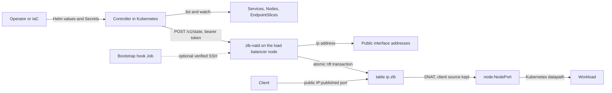
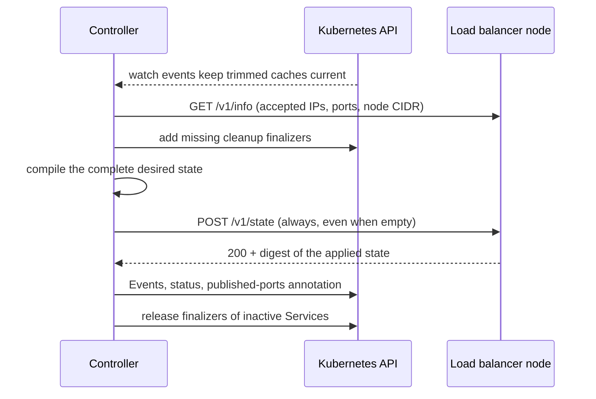
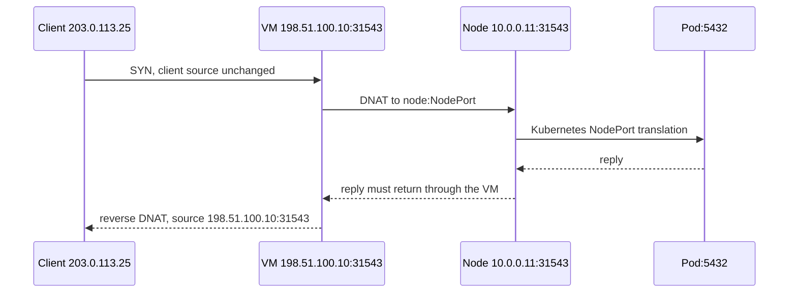

# zlb internals

How zlb works, for reviewers and anyone debugging below the [operator guide](guide.md).
Examples use the guide's topology plus Ready nodes `10.0.0.11` and `10.0.0.12`.

- [Components and ownership](#components-and-ownership)
- [Reconciliation](#reconciliation)
- [Wire format and HTTP API](#wire-format-and-http-api)
- [Verified apply](#verified-apply)
- [Generated rules](#generated-rules)
- [Packet path](#packet-path)
- [SSH bootstrap](#ssh-bootstrap)
- [Failures and restarts](#failures-and-restarts)
- [Limits and non-goals](#limits-and-non-goals)
- [Source map](#source-map)

## Components and ownership



| Owner | Owns |
| --- | --- |
| Helm | controller Deployment, ServiceAccount, RBAC, pool ConfigMap; on 1.30+ the admission policy; with bootstrap the hook Job, optional CronJob and quiesce hook. Not the Secrets or the VM. |
| Controller | listeners, its `zlb.zarrino.tech/cleanup` finalizer, `status.loadBalancer.ingress`, the `zlb.zarrino.tech/published-ports` annotation, Warning Events. Never NodePorts, Service types or policies. |
| Daemon | one nftables table and the interface addresses it added. Its IP and backend allowlists are independent of the controller's pools. |
| Bootstrap | on the VM: package, `zlb-natd` user, token and TLS files, unit, forwarding sysctl, revision marker. |
| Infrastructure | the VM, NICs, upstream addresses and routes, return routing, firewall, SSH access and host keys. |

The admission policy exists because RBAC cannot limit `patch services` to fields: it lets
the controller's ServiceAccount change only its finalizer and its annotation. Status goes
through `services/status`, which cannot touch spec or metadata.

## Reconciliation



- **Caches.** Each of Services, Nodes and EndpointSlices is listed page by page (all pages
  must succeed), then watched with bookmarks; trimmed objects keep only what the compiler
  reads. A tick refuses to run unless every cache holds a complete list with a watch open
  from it. An error or expired watch withdraws that until the next list and watch; a planned
  `--resync` keeps serving the complete cache while it relists. The controller's own writes
  are written through to the cache.
- **Compile.** A pure function of the caches, the pool JSON and `/v1/info`. Per-Service
  problems (bad ports, pool policy, collisions, anything the daemon would refuse) drop only
  that Service and become its Warning Event. Invalid pool policy, a node-CIDR mismatch or a
  failed push fail the whole tick, so no partial or empty state is ever sent by accident.
- **Order.** A Service gets its finalizer before it can be published, and status,
  annotation and finalizer release only follow the daemon's acknowledgement. Each write is
  conditional on `resourceVersion`; one Service's failed write does not stop the others, but
  marks the tick failed (not Ready). Unchanged status is not rewritten; a missing `ipMode`
  (Kubernetes before 1.30) counts as unchanged.
- **Ownership.** Services with no class or `zlb.zarrino.tech/gateway` are adopted. There is
  no leader election: exactly one controller must own one daemon's state.

## Wire format and HTTP API

The controller sends the whole state every tick. Each distinct node set appears once in
`backend_sets`, so the request grows with listeners plus nodes:

```json
{
  "version": 3,
  "backend_sets": [["10.0.0.11", "10.0.0.12"]],
  "listeners": [
    {"ip": "198.51.100.10", "port": 31543, "protocol": "TCP", "source_ranges": [],
     "backend_port": 31543, "backend_set": 0}
  ]
}
```

Version 2, which listed backends per listener, is still accepted. The token goes in
`Authorization: Bearer`, never in the body. Do not POST a hand-written state to a live
daemon: it replaces every listener.

| Request | Result |
| --- | --- |
| `POST /v1/state` | `200 {"digest": ...}` after a verified apply (SHA-256 of the canonical JSON; the controller checks it), `400` invalid state or an address conflict on the VM (logged as `rejected desired state`), `401` bad token, `503` apply failed or token unreadable |
| `GET /v1/info` (token) | accepted versions, public IPs, node CIDR, forbidden ports, backend port range |
| `GET /healthz` | `{"alive": true}`: process liveness only |

Limits: body 1 byte to 2 MiB with Content-Length (no chunked encoding), 10 s per socket
operation and 30 s per request, `--max-connections` concurrent connections, sources outside
`--allow-from` closed before reading. The state allows 4096 listeners, 4096 backend sets of up
to 4096 nodes, 1024 source ranges per listener, IPv4 only. The daemon rejects IPs outside its
`--ip` list, backends outside its node CIDR or backend port range, duplicate
`(IP, protocol, port)` listeners and forbidden ports. The controller waits 90 s.

## Verified apply

The daemon validates and normalizes the state, then under a lock:

1. If it equals the last verified state and the kernel's nftables ruleset generation (read
   over netlink; it moves on every committed change in any table) has not moved, re-asserts
   the interface addresses and answers. This is the steady state; no nftables state is listed.
2. Otherwise lists the owned table. If only another table changed (same fingerprint), answers
   as above.
3. Otherwise renders the new table, carrying over counter values, and checks the whole
   transaction with `nft --check`.
4. Keeps the old table as text, adds missing addresses (journaling each), and commits
   `delete table ip zlb` plus the new table in one atomic transaction.
5. Reads it back: ownership marker, hooks and priorities, chains, rule counts per chain, map
   element counts, counter names. Records the fingerprint and generation.
6. Removes addresses that are no longer configured, then acknowledges.

Any failure from step 4 restores and re-verifies the previous table and addresses and is
never acknowledged; a failed rollback is logged as `ROLLBACK FAILED`. Every nft call has a
30 s timeout. A table without zlb's `zlb:v2:`/`zlb:v3:` marker is never touched.

The address journal (`/var/lib/zlb/<table>-addresses.json`, replaced atomically) records
only addresses the daemon added. Cleanup removes exactly those; preexisting addresses and
prefixes an administrator changed survive. A crash between adding an address and journaling
it leaves an unowned address for review rather than risking deleting someone else's.
Addresses are added with `noprefixroute`; zlb does no ARP announcement, duplicate detection
or provider allocation.

## Generated rules

The renderer's output for the example state (checked against the code by
`scripts/check_docs.py`):

```nft
table ip zlb {
comment "zlb:v3:66260ce740777f01e6803ecfb57e537958d40417676cc33df5572a87b638d958";
map dispatch {
    type ipv4_addr . inet_proto . inet_service : verdict
    elements = { 198.51.100.10 . tcp . 31543 : jump l_2671d531e4b39b30 }
}
map guard {
    type ipv4_addr . inet_proto . inet_service : verdict
    elements = { 198.51.100.10 . tcp . 31543 : jump open }
}
counter c_2671d531e4b39b30 { packets 0 bytes 0 }
chain l_2671d531e4b39b30 {
    counter name "c_2671d531e4b39b30" meta l4proto tcp dnat ip to numgen inc mod 2 map { 0 : 10.0.0.11 . 31543, 1 : 10.0.0.12 . 31543 }
}
chain open {
    ip daddr 10.0.0.0/24 ct status dnat counter accept;
    counter drop;
}
chain prerouting {
    type nat hook prerouting priority -110; policy accept;
    ip daddr . meta l4proto . th dport vmap @dispatch;
}
chain forward {
    type filter hook forward priority -10; policy accept;
    ct state established,related ct status dnat ct original ip daddr { 198.51.100.10 } ct reply ip saddr 10.0.0.0/24 counter accept;
    iifname "eth0" ct state invalid,untracked counter drop;
    iifname "eth0" ct state new ct status & dnat == 0 counter drop;
    ct direction original ct original ip daddr . ct original protocol . ct original proto-dst vmap @guard;
}
chain input {
    type filter hook input priority -10; policy accept;
    ct direction original ct original ip daddr . ct original protocol . ct original proto-dst vmap @guard;
}
}
```

- **prerouting** (nat, -110, before the usual -100) looks up `IP . protocol . port` in
  `@dispatch` and jumps to the listener's chain `l_<id>` (`<id>`: first 16 hex digits of the
  SHA-256 of `[IP, protocol, port]`). One map lookup per packet, one chain per listener.
- **l_\<id\>** gates on source ranges when set, counts new connections in `c_<id>` (kept
  across applies) and picks a backend round-robin with `numgen`. Conntrack pins each flow.
- **forward** (filter, -10) accepts established and related packets of zlb flows, drops
  invalid packets and new non-DNAT connections from the public interface (unless
  `--allow-foreign-forwarding`), then looks up the
  original tuple in `@guard`: `open`, or `a_<id>` for listeners with source ranges, accepts
  DNATed traffic to the node CIDR and drops the rest of that tuple.
- **input** (filter, -10) uses `@guard` too, so denied or empty-backend listener traffic
  never reaches a local socket. An empty-backend listener maps straight to `drop`.
- `--isolate-public-ips` adds input rules that accept only replies and ping to the public
  IPs. `--hairpin-snat-from` adds a `postrouting` nat chain (priority 100) and a `hairpin`
  set of the listener tuples; it masquerades flows from those sources whose original
  (IP, protocol, port) is in the set. Nothing else is SNATed, and there is no OUTPUT NAT.
- Base chains use policy accept: unmatched traffic continues, and other tables can still drop.

## Packet path



The kernel does all forwarding; the daemon is not in the data path, so a controller, API or
daemon outage leaves existing rules serving.

### Return routing example

With a separate egress router, infrastructure (not zlb) must steer NodePort replies back to
the VM. One way, assuming router node-side `10.0.0.1`, VM node-side `10.0.0.3`, router
interface `rtr-nodes0`, VM node-facing interface `node0` and provider gateway
`198.51.100.1` on `eth0`:

```nft
# Egress router: mark NodePort replies from the nodes.
table ip example_lb_return {
  chain prerouting {
    type filter hook prerouting priority mangle; policy accept;
    iifname "rtr-nodes0" ip saddr 10.0.0.0/24 meta l4proto { tcp, udp, sctp } th sport 30000-32767 meta mark set 0x5a1b;
  }
}
```

```sh
# Egress router
ip rule add priority 1100 fwmark 0x5a1b lookup 200
ip route replace default via 10.0.0.3 dev rtr-nodes0 table 200
```

```nft
# VM: mark replies of zlb flows so they leave through the public uplink.
table ip example_lb_network {
  chain prerouting {
    type filter hook prerouting priority mangle; policy accept;
    iifname "node0" ct direction reply ct status dnat ct original ip daddr 198.51.100.10 meta mark set 0x5a1c;
  }
}
```

```sh
# VM
ip route replace 198.51.100.0/24 dev eth0 scope link table 201
ip route replace 10.0.0.0/24 dev node0 scope link table 201
ip route replace default via 198.51.100.1 dev eth0 table 201
ip rule add priority 1101 fwmark 0x5a1c lookup 201
ip rule add priority 1102 from 198.51.100.10/32 lookup 201
ip route get 203.0.113.25 mark 0x5a1c   # verify
```

A broad source-port mark also catches private clients calling NodePorts directly; adapt it,
the priorities and reverse-path filtering to your real paths. Removing the last public
address can remove routes that depend on it; restore them in your VM lifecycle.

## SSH bootstrap

The hook pod copies the key and known_hosts to mode-0600 temporary files and runs:

```sh
ssh -o BatchMode=yes -o StrictHostKeyChecking=yes -o UserKnownHostsFile=TEMP_KNOWN_HOSTS \
  -o IdentitiesOnly=yes -o ConnectTimeout=10 -o ServerAliveInterval=15 -o ServerAliveCountMax=3 \
  -i TEMP_KEY -p 22 root@10.0.0.3 REMOTE_SCRIPT
```

`REMOTE_SCRIPT` is in [bootstrap.py](../zlb/bootstrap.py); its JSON payload (the `zlb`
package source, token, TLS files and generated unit) travels on stdin. A non-root user runs
it through `sudo -n`. The whole run has a 900 s timeout and returns a receipt hash that the
pod verifies. The shell wrapper installs `python3` with apt if it is missing; then, under
`/run/zlb-bootstrap.lock`, the script:

1. Returns `changed: false` if package, unit, files, tools, revision and an active service all
   match. Refuses to replace a `zlb-natd.service` that does not run `zlb.natd`.
2. Installs `nftables` and `iproute2` with apt if missing and creates the `zlb-natd` user.
3. If the package, unit or TLS files changed or the daemon is not running, stages the package as `/opt/zlb/zlb.new` and
   swaps it in.
4. Writes the token and TLS files (key and token `root:zlb-natd` 0640), the unit and
   `/etc/sysctl.d/90-zlb-forwarding.conf` atomically, then runs `sysctl -w`,
   `systemd-analyze verify` and `daemon-reload`.
5. Only in that case: enables the unit, writes `/run/zlb/zlb.keep` if
   the daemon was running, starts or restarts it, and checks `is-active` for three seconds.
   A token-only change needs no restart; the daemon re-reads its token per request.
6. Writes `/var/lib/zlb-bootstrap/revision`.

On failure after the swap it stops the new daemon while its own cleanup code is installed:
with the keep marker if a daemon was serving before, otherwise followed by that cleanup (for
example on a first install) so nothing it created survives. Then it restores the previous
package, unit and files and starts the previous daemon if one was running. The original error
is re-raised. apt changes and the sysctl are not rolled back.

The generated unit matches [the example unit](../examples/systemd/zlb-natd.service) (a unit
test keeps their sandbox identical): `User=zlb-natd`, `AmbientCapabilities=CAP_NET_ADMIN`,
`RuntimeDirectory=zlb` and `StateDirectory=zlb` (0700), `ProtectSystem=strict`, restricted
address families and system calls, `Restart=on-failure`, and `ExecStopPost` running
`--cleanup` with the same flags.

## Failures and restarts

| Event | Effect |
| --- | --- |
| Controller or Kubernetes API down | Installed rules keep serving; there is no lease or expiry. |
| Daemon API unreachable | The controller retries; no new assignments, no finalizer releases. |
| Daemon crash | systemd passes `$SERVICE_RESULT` ≠ `success`; cleanup keeps everything; the restarted daemon keeps the table until the next push. |
| Managed restart (bootstrap upgrade or keep marker) | Cleanup keeps everything; systemd deletes the marker with `/run/zlb`. |
| Clean stop, shutdown | Cleanup removes the owned table and addresses. |
| Start limit reached | Rules stay installed; run `--cleanup` to remove them. |
| VM reboot | The daemon re-adds its addresses and an empty table; the next push restores listeners. |
| VM lost | Traffic through it fails; there is no load balancer node HA. |
| A push times out after the commit | The next full push is idempotent and resolves it. |
| Foreign table, journal for another interface, lock held | Fails closed; zlb never takes over unrelated state. |
| Two controllers | Not detected: each push replaces the other's state and listeners flap. Run exactly one. |

There are no active health checks: Node and EndpointSlice readiness decide eligibility, and
`Local` skips terminating endpoints even while they still serve.

## Limits and non-goals

- IPv4 only; one node CIDR, one controller and one daemon per state; no HA or leader election.
- One IP per Service. No IP acquisition from providers, route discovery, ARP announcement or
  DNS management.
- No health probes, session affinity, weights or least-connections; conntrack gives flow
  affinity only.
- `sessionAffinity`, `healthCheckNodePort`, `trafficDistribution` and other load-balancer
  annotations are ignored; `spec.loadBalancerIP` is rejected.
- Reserved literal ports come only from administrator reservations; Services cannot request
  arbitrary public ports.
- No SNAT except the opt-in hairpin, no OUTPUT NAT, no conntrack flushing, no TLS
  termination or PROXY protocol.

## Source map

| Path | Contents |
| --- | --- |
| [controller.py](../zlb/controller.py), [cache.py](../zlb/cache.py), [kube.py](../zlb/kube.py) | reconcile loop, watch caches, conditional writes, Events |
| [compiler.py](../zlb/compiler.py), [pools.py](../zlb/pools.py) | IP and port decisions, backend selection, collisions |
| [model.py](../zlb/model.py) | wire format, validation limits, digest |
| [natd.py](../zlb/natd.py), [addresses.py](../zlb/addresses.py) | renderer, verified apply, generation check, cleanup, address journal |
| [http_api.py](../zlb/http_api.py) | authentication, TLS, endpoints, limits |
| [bootstrap.py](../zlb/bootstrap.py), [quiesce.py](../zlb/quiesce.py) | SSH bootstrap, generated unit, rollback; upgrade quiesce hook |
| [charts/zlb/templates](../charts/zlb/templates) | Deployment, RBAC, admission policy, bootstrap and quiesce hooks |
