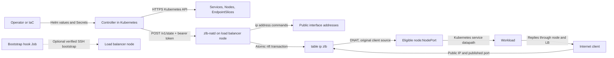
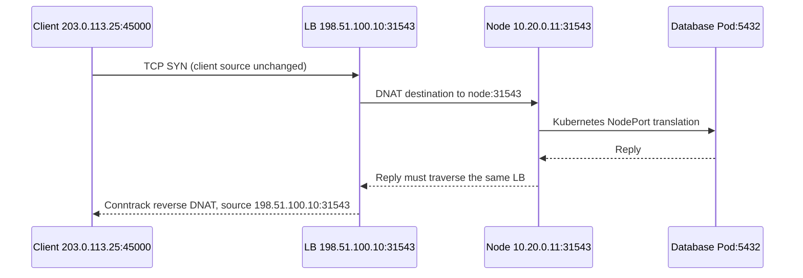

# Installation and packet lifecycle

This guide follows the implemented controller and daemon, from installation to packet
forwarding and removal. It describes application 0.4.0, chart 0.2.0, and wire schema v3.
Commands marked **operator** are run by you or your IaC. Commands marked **automatic**
are run by zlb. Infrastructure examples illustrate a topology; zlb does not install them.
All external addresses here are documentation addresses and must be replaced.

## Contents

1. [Topology and ownership](#1-topology-and-ownership)
2. [Install the controller](#2-install-the-controller-operator)
3. [SSH bootstrap](#3-ssh-bootstrap-automatic-when-enabled)
4. [Daemon startup and IP assignment](#4-daemon-startup-and-ip-assignment-automatic)
5. [Create Services and resolve public ports](#5-create-services-and-resolve-public-ports)
6. [A reconciliation tick](#6-a-reconciliation-tick-automatic)
7. [The HTTP contract and verified apply](#7-the-http-contract-and-verified-apply)
8. [Generated nftables rules](#8-generated-nftables-rules)
9. [Packet and return paths](#9-packet-and-return-paths)
10. [Inspect and diagnose](#10-inspect-and-diagnose-operator)
11. [Updates, removal, and recovery](#11-updates-removal-and-recovery)
12. [Edge cases and limits](#12-edge-cases-and-limits)
13. [Source map](#13-source-map)

## 1. Topology and ownership

The **load balancer node** is the external Linux machine that owns public addresses and
DNATs traffic to Kubernetes NodePorts. It does not need to join Kubernetes. It can be
separate from the site's VPN or internet-egress router.



**Helm owns** a Deployment, ServiceAccount, ClusterRole, ClusterRoleBinding, pool
ConfigMap, an optional bootstrap hook Job/CronJob, and on Kubernetes 1.30+ a
ValidatingAdmissionPolicy that limits the controller's Service writes to its own finalizer.
It references existing API-token and optional SSH Secrets; it does not create those Secrets
or a VM. There is no in-cluster API Service for the external daemon.

**The controller owns** desired listeners, its cleanup finalizer, warning Events, and
`status.loadBalancer.ingress`. It reads Service ports; it does not allocate NodePorts,
change Service type, install application policies, or create Ingress resources.

**The daemon owns** one nftables table and the interface addresses it explicitly added.
Its allowed public IPs and backend CIDR are independent of Kubernetes pool policy.

**Infrastructure owns** the VM, NIC names, upstream allocation/routing, private reachability,
return routes, firewall admission, SSH access and trusted host keys. The controller's
optional bootstrap owns its package, token, systemd unit and IPv4-forwarding sysctl on that VM.

The examples use:

- LB private/API address `10.0.0.3:9808`, public interface `eth1`.
- Public address `198.51.100.10/32`; node CIDR `10.20.0.0/24`.
- Ready Kubernetes nodes `10.20.0.11` and `10.20.0.12`.
- Ingress Service `ingress/edge`: public 80/443, NodePorts 30080/30443.
- Ordinary Service `apps/database`: Service port 5432, NodePort 31543.

Public `/32` assignment does not create an upstream route or an on-link route to your
provider router. Choose the real prefix and routing model for your environment.

## 2. Install the controller (operator)

Clone `https://github.com/abexamir/zlb` and run these from the repository root. Set the explicit target cluster and image first:

```sh
export ZLB_KUBECONFIG=/absolute/path/to/target-kubeconfig
export ZLB_CONTEXT=your-target-context
export ZLB_IMAGE=ghcr.io/abexamir/zlb:0.4.0
export ZLB_LB_NODE_SSH=root@10.0.0.3
kubectl --kubeconfig "$ZLB_KUBECONFIG" --context "$ZLB_CONTEXT" cluster-info
```

The public multi-architecture image is `ghcr.io/abexamir/zlb:0.4.0`. To build a
custom image instead, set `ZLB_IMAGE` to a registry/tag you own and run:

```sh
docker buildx build --platform linux/amd64 --push --tag "$ZLB_IMAGE" .
kubectl --kubeconfig "$ZLB_KUBECONFIG" --context "$ZLB_CONTEXT" \
  create namespace zlb-system --dry-run=client -o yaml |
  kubectl --kubeconfig "$ZLB_KUBECONFIG" --context "$ZLB_CONTEXT" apply -f -
```

Create a token without placing it in shell arguments or manifests committed to Git:

```sh
ZLB_TOKEN_FILE=$(mktemp)
chmod 600 "$ZLB_TOKEN_FILE"
python3 -c 'import secrets; print(secrets.token_hex(32))' > "$ZLB_TOKEN_FILE"
kubectl --kubeconfig "$ZLB_KUBECONFIG" --context "$ZLB_CONTEXT" -n zlb-system \
  create secret generic zlb-api-token --from-file=token="$ZLB_TOKEN_FILE" \
  --dry-run=client -o yaml |
  kubectl --kubeconfig "$ZLB_KUBECONFIG" --context "$ZLB_CONTEXT" apply -f -
rm "$ZLB_TOKEN_FILE"
```

With SSH bootstrap enabled, the bootstrap Job copies that token from the Secret to the VM.
For a preprovisioned daemon, install the same token securely on the VM before deleting
its local staging file. Secret storage/encryption and registry pull credentials are operator inputs.

For bootstrap, generate/provision a dedicated key and add its public key to the chosen VM's
SSH authorization through IaC. Obtain the VM's host public key from the provisioning system;
this example expects trusted `known_hosts` entries for `10.0.0.3` already prepared:

```sh
kubectl --kubeconfig "$ZLB_KUBECONFIG" --context "$ZLB_CONTEXT" -n zlb-system \
  create secret generic zlb-ssh \
  --from-file=private_key=/secure/path/to/dedicated-private-key \
  --from-file=known_hosts=/secure/path/to/trusted-known-hosts \
  --dry-run=client -o yaml |
  kubectl --kubeconfig "$ZLB_KUBECONFIG" --context "$ZLB_CONTEXT" apply -f -
```

Create `your-values.yaml`, substituting the image you built and your actual network values:

```yaml
fullnameOverride: zlb-controller
image:
  repository: ghcr.io/abexamir/zlb
  tag: "0.4.0"
lbNode:
  url: http://10.0.0.3:9808
  allowPrivateHTTP: true
  existingSecret: zlb-api-token
nodeCIDR: 10.20.0.0/24
interval: 5
bootstrap:
  enabled: true
  existingSecret: zlb-ssh
  sshHost: 10.0.0.3
  sshUser: root
  sshPort: 22
  publicInterface: eth1
  publicIPs: [198.51.100.10/32]
pools:
  default_pool: public
  blocked_ports: [9808]
  pools:
    - name: public
      ips: [198.51.100.10]
      reservations:
        - ip: 198.51.100.10
          ports: [80, 443]
          service: ingress/edge
```

This example uses private HTTP. For HTTPS, use an `https://` `lbNode.url` with
`lbNode.caConfigMap` and set `bootstrap.tlsSecret`; see
[securing the daemon API](installation.md#securing-the-daemon-api). Bootstrap's host and native API listener must describe
reachable addresses on the same explicitly chosen LB machine.

```sh
helm lint charts/zlb -f your-values.yaml
helm template zlb charts/zlb -n zlb-system -f your-values.yaml > /tmp/zlb-rendered.yaml
helm upgrade --install zlb oci://ghcr.io/abexamir/charts/zlb --version 0.2.0 \
  -n zlb-system --create-namespace \
  --kubeconfig "$ZLB_KUBECONFIG" --kube-context "$ZLB_CONTEXT" \
  -f your-values.yaml --wait --timeout 15m
```

The chart uses one replica and `Recreate`; two controllers must not compete over one daemon.
RBAC permits list/get Services, Nodes and EndpointSlices; patch Services and their status;
and create Events. The controller runs as UID/GID 65532 with no Linux capabilities,
read-only root filesystem, and temporary writable memory storage. It does not run `nft` in Kubernetes.

The rendered controller arguments are equivalent to:

```sh
python -m zlb.controller \
  --lb-node=http://10.0.0.3:9808 --allow-private-http \
  --token-file=/var/run/zlb/token --pool-config=/etc/zlb/pools.json \
  --node-cidr=10.20.0.0/24 --interval=5 --ready-file=/tmp/zlb-ready

# Separate pre-install/pre-upgrade hook Job (no Kubernetes API token):
python -m zlb.bootstrap --lb-node=http://10.0.0.3:9808 --token-file=/var/run/zlb/token \
  --key-file=/var/run/zlb-ssh/private_key --known-hosts-file=/var/run/zlb-ssh/known_hosts \
  --ssh-host=10.0.0.3 --ssh-user=root --ssh-port=22 --public-interface=eth1 \
  --ip=198.51.100.10/32 --node-cidr=10.20.0.0/24 --backend-port-range=30000-32767
```

The pool JSON is mounted as a ConfigMap directory; API token and SSH data are Secret mounts.
The chart's pool checksum triggers a controller replacement when Helm changes pool policy.
Helm readiness checks a timestamp file updated after a successful tick, with a 30-second age
limit. It does not check application health or external reachability. There is no liveness probe.
The old Helm key `gateway` is rejected; use `lbNode`. The historical LoadBalancer class
identifier `zlb.zarrino.tech/gateway` is retained for compatibility.

## 3. SSH bootstrap (automatic, when enabled)

The Helm hook Job (or optional CronJob) runs `python -m zlb.bootstrap` once. It creates
mode-0600 temporary key and host-key files, then invokes OpenSSH with these options:

```sh
ssh -o BatchMode=yes -o StrictHostKeyChecking=yes \
  -o UserKnownHostsFile=TEMP_KNOWN_HOSTS -o IdentitiesOnly=yes \
  -o ConnectTimeout=10 -o ServerAliveInterval=15 -o ServerAliveCountMax=3 \
  -i TEMP_PRIVATE_KEY -p 22 root@10.0.0.3 REMOTE_SCRIPT
```

`REMOTE_SCRIPT` is the source in [bootstrap.py](../zlb/bootstrap.py), not a separately hosted
installer. The JSON payload travels on SSH stdin and contains the daemon's Python source,
token, and generated unit. The overall SSH operation has a 900-second timeout. A non-root
SSH user invokes `sudo -n sh -c ...`; passwordless root-equivalent sudo is required.

If Python is missing, the initial remote shell runs:

```sh
apt-get update
DEBIAN_FRONTEND=noninteractive apt-get install -y python3
```

The remote Python process locks `/run/zlb-bootstrap.lock` using `flock`, hashes the payload,
and checks package files, unit, token, revision marker, required tools and active service.
When they all match it returns `changed: false` and does not restart the service.

If `nft` or `ip` is missing, it runs:

```sh
apt-get update
env DEBIAN_FRONTEND=noninteractive apt-get install -y nftables iproute2
```

It refuses to replace an existing `zlb-natd.service` that does not invoke `-m zlb.natd`.
For an update it backs up the previous package, unit and files. A change to the token
alone is written in place: the daemon re-reads its token for every request, so it is not
restarted. Otherwise the new package is staged and swapped in with directory renames, then:

```sh
# Files are written by Python, with temporary files, fsync and os.replace.
sysctl -w net.ipv4.ip_forward=1
systemd-analyze verify /etc/systemd/system/zlb-natd.service
systemctl daemon-reload
systemctl enable zlb-natd.service
# When it was running: touch /run/zlb/zlb.keep, so the stop keeps forwarding in place.
systemctl restart zlb-natd.service      # or: systemctl start, on first install
systemctl is-active --quiet zlb-natd.service
```

Installed paths:

- `/opt/zlb/zlb/*.py`: package source, mode 0644.
- `/etc/zlb/token`: API token, `root:zlb-natd` mode 0640.
- `/etc/zlb/tls.crt`, `tls.key`, `client-ca.crt` (HTTPS only): key `root:zlb-natd` 0640, certificates 0644.
- `/etc/systemd/system/zlb-natd.service`: generated unit, mode 0644.
- `/etc/sysctl.d/90-zlb-forwarding.conf`: `net.ipv4.ip_forward=1`, mode 0644.
- `/var/lib/zlb-bootstrap/revision`: successful payload SHA-256, mode 0600.
- `/var/lib/zlb-bootstrap/backup-*`: temporary rollback backup, removed on exit.

The generated unit for this example is:

```ini
[Unit]
Description=zlb nftables load balancer node (controller managed)
After=network-online.target
Wants=network-online.target
[Service]
Type=simple
WorkingDirectory=/opt/zlb
ExecStart=/usr/bin/python3 -m zlb.natd --listen 10.0.0.3 --port 9808 --public-interface eth1 --node-cidr 10.20.0.0/24 --backend-port-range 30000-32767 --ip 198.51.100.10/32 --token-file /etc/zlb/token
ExecStopPost=/usr/bin/python3 -m zlb.natd --listen 10.0.0.3 --port 9808 --public-interface eth1 --node-cidr 10.20.0.0/24 --backend-port-range 30000-32767 --ip 198.51.100.10/32 --cleanup
Restart=on-failure
RestartSec=2
User=zlb-natd
Group=zlb-natd
AmbientCapabilities=CAP_NET_ADMIN
CapabilityBoundingSet=CAP_NET_ADMIN
NoNewPrivileges=true
RuntimeDirectory=zlb
RuntimeDirectoryMode=0700
StateDirectory=zlb
StateDirectoryMode=0700
UMask=0077
ProtectSystem=strict
ProtectHome=true
PrivateTmp=true
PrivateDevices=true
ProtectKernelTunables=true
ProtectKernelLogs=true
ProtectControlGroups=true
ProtectClock=true
ProtectHostname=true
RestrictAddressFamilies=AF_UNIX AF_INET AF_INET6 AF_NETLINK
RestrictNamespaces=true
RestrictRealtime=true
RestrictSUIDSGID=true
LockPersonality=true
MemoryDenyWriteExecute=true
SystemCallArchitectures=native
SystemCallFilter=@system-service
SystemCallErrorNumber=EPERM
[Install]
WantedBy=multi-user.target
```

The daemon runs as the unprivileged system user `zlb-natd`, which bootstrap creates, with
`CAP_NET_ADMIN` as its only capability (plus `CAP_NET_BIND_SERVICE` for an API port below
1024). Systemd creates `/run/zlb` and `/var/lib/zlb` owned by that user with mode 0700. The
unit forbids privilege escalation, hides home directories and devices, makes most of the
filesystem and kernel tunables read-only, and restricts address families and system calls.
`systemd-analyze security` rates it 2.1 (OK). Infrastructure may add routing dependencies or an
`ExecStartPost` drop-in without changing the generated unit itself.

On failure bootstrap restores the package, unit and files and reloads systemd. If the old
service was running it restarts it, again with the keep marker; otherwise it stops the
candidate. A rollback problem is reported without hiding the original error. Apt package changes,
the forwarding sysctl, enablement state and infrastructure changes are not transactional
rollback targets. A failed first install must be inspected; a stopped but enabled candidate
can restart after reboot. Bootstrap verifies local service activity and a receipt hash;
the subsequent HTTP reconciliation verifies that it actually accepts rules.

## 4. Daemon startup and IP assignment (automatic)

The daemon reads the token, which must have at least 32 ASCII non-whitespace characters.
It takes a nonblocking process lock at `/run/zlb/zlb.lock`, checks `nft --version`, verifies
`/proc/sys/net/ipv4/ip_forward` is `1`, and inventories interfaces:

```sh
ip -j address show
nft -j list tables
# When an owned table exists:
nft -j -s list table ip zlb
nft -s list table ip zlb
```

An existing table must have a `zlb:v2:` or `zlb:v3:` ownership comment. Otherwise the daemon refuses to
touch it. If no table exists, it applies an empty v3 snapshot, creating the base chains
and claiming configured addresses. If a table exists, it leaves it until the next snapshot.
Then it listens on `10.0.0.3:9808`; `/healthz` reports process liveness only.

On apply, each missing configured public address is added with:

```sh
ip address add 198.51.100.10/32 dev eth1 noprefixroute
```

The daemon writes `/var/lib/zlb/zlb-addresses.json` atomically, recording only addresses
it added, the interface, and journal version. All addresses in the daemon allowlist are
managed, even if no Service currently uses them. Kubernetes pool allocation and host address
ownership are separate operations; the daemon does not request new addresses from a provider.

A preexisting address on the chosen interface is left alone and not adopted into ownership.
An address on a different local interface is rejected. This inventory cannot detect another
machine using the same address. The daemon does not perform ARP duplicate-address detection,
provider allocation, BGP advertisement, or gratuitous ARP announcements.

After a verified apply, obsolete journal-owned addresses are removed with:

```sh
ip address del OLD_IP/PREFIX dev eth1
```

Changing the public interface while keeping its old journal is rejected. An owned prefix
change requires cleanup first. Do not delete the journal to force a change: that loses the
information needed for safe cleanup. Preexisting administrator-owned IPs survive cleanup.

## 5. Create Services and resolve public ports

Create the namespaces and deploy your chosen ingress controller and database first. These
Service examples select existing Pods; they do not install workloads.

```sh
kubectl --kubeconfig "$ZLB_KUBECONFIG" --context "$ZLB_CONTEXT" create namespace ingress \
  --dry-run=client -o yaml | kubectl --kubeconfig "$ZLB_KUBECONFIG" --context "$ZLB_CONTEXT" apply -f -
kubectl --kubeconfig "$ZLB_KUBECONFIG" --context "$ZLB_CONTEXT" create namespace apps \
  --dry-run=client -o yaml | kubectl --kubeconfig "$ZLB_KUBECONFIG" --context "$ZLB_CONTEXT" apply -f -
```

Reserved ingress (`edge-service.yaml`):

```yaml
apiVersion: v1
kind: Service
metadata:
  name: edge
  namespace: ingress
spec:
  type: LoadBalancer
  externalTrafficPolicy: Local
  selector:
    app: edge
  ports:
    - name: web
      protocol: TCP
      port: 80
      targetPort: 8000
      nodePort: 30080
    - name: websecure
      protocol: TCP
      port: 443
      targetPort: 8443
      nodePort: 30443
```

Ordinary shared-IP Service (`database-service.yaml`):

```yaml
apiVersion: v1
kind: Service
metadata:
  name: database
  namespace: apps
spec:
  type: LoadBalancer
  selector:
    app: database
  ports:
    - name: database
      protocol: TCP
      port: 5432
      targetPort: 5432
      nodePort: 31543
```

```sh
kubectl --kubeconfig "$ZLB_KUBECONFIG" --context "$ZLB_CONTEXT" \
  apply -f edge-service.yaml -f database-service.yaml
```

NodePorts are explicit here for a reproducible illustration. Omit `nodePort` for Kubernetes
to allocate an available value from its configured range. zlb never runs a NodePort allocator.
Leave `allocateLoadBalancerNodePorts` enabled and ensure every Service port has a NodePort.

The resolved paths are:

```text
ingress/edge:
  198.51.100.10:80  -> eligible node:30080 -> Pod:8000
  198.51.100.10:443 -> eligible node:30443 -> Pod:8443
apps/database:
  198.51.100.10:31543 -> eligible node:31543 -> Pod:5432
```

The pool's exact `namespace/name` reservation grants literal Service ports. Unreserved ports
publish their NodePort, even if the Service's `port` is 80 or 443. The ingress reservation
is not an application annotation and does not modify the Service's port definitions.

A reservation without `ports` dedicates the whole IP to one Service. Its actual Service
ports publish literally; no wildcard listener is created. A reservation stays reserved while
its Service is absent. Other Services can share a port-reserved IP on their own NodePorts,
but cannot use a whole-IP reservation belonging to someone else.

Pool/IP requests are optional:

```yaml
metadata:
  annotations:
    zlb.zarrino.tech/pool: public
    zlb.zarrino.tech/ip: "198.51.100.10"
```

IP choice is: explicit eligible requested IP; otherwise an existing eligible status IP;
otherwise an IP reserved for that Service; otherwise another eligible configured IP.
Pool ordering is deterministic, not a least-loaded or random allocator. An existing valid
IP wins even if an administrator later adds a reservation on another IP. zlb does not search
for a different IP after a listener collision or dynamically acquire more addresses.

`kubectl get services` displays **Service port → NodePort**, not zlb's public port.
The controller writes the assigned IP with `ipMode: Proxy` into status, plus its finalizer;
it currently does not write public-port annotations. To identify an endpoint, combine pool
policy with Service ports, or inspect the daemon's live nftables rules.

## 6. A reconciliation tick (automatic)

```mermaid
sequenceDiagram
    participant C as Controller
    participant K as Kubernetes API
    participant L as Load balancer node
    K-->>C: Watch events keep trimmed Service, Node and EndpointSlice caches current
    C->>C: Read the synced caches (no API reads)
    C->>K: PATCH missing cleanup finalizers
    C->>C: Validate pools and compile complete desired snapshot
    C->>L: POST /v1/state (including empty state)
    L->>L: Validate, nft --check, add IPs, atomic apply, readback
    L-->>C: HTTP 200 + matching digest
    C->>K: Warning Events and resourceVersion-guarded status patches
    C->>K: Release cleanup finalizer for inactive Services
    C->>C: Write readiness timestamp; sleep with jitter
```

The controller uses its in-cluster ServiceAccount token and cluster CA. It does not invoke
`kubectl`, `helm`, `ssh` for reconciliation itself, or any CNI command. SSH is used only by
optional bootstrap. It reloads pool JSON at the beginning of each tick.

Services, Nodes and EndpointSlices come from three watch-backed caches. Each lists its
resource once (every page must succeed), then follows a watch with bookmarks, and relists
after an error, an expired resourceVersion, or `--resync` seconds (default 600):

```text
GET /api/v1/services?limit=500[&continue=...]                  then ?watch=1&resourceVersion=...
GET /api/v1/nodes?limit=500[&continue=...]                     then ?watch=1&resourceVersion=...
GET /apis/discovery.k8s.io/v1/endpointslices?limit=500[&...]   then ?watch=1&resourceVersion=...
```

The caches keep only the fields the compiler reads, and each list page is trimmed before the
next is fetched. EndpointSlices are reduced to their eligible node names and ports: a relist
of 20,000 slices peaks at about 19 MiB, against about 158 MiB when full pages were held. A
tick reads the caches without API calls. It fails without pushing anything unless all three
caches hold a complete list and have a watch open from it; readiness is withdrawn as soon as
a watch fails or expires, and returns only when the next watch opens. A planned `--resync`
relist follows a watch that ended cleanly, so the cache keeps serving while it runs. Objects
returned by the controller's own patches are written through to the cache. The caches are
not one atomic cross-resource Kubernetes transaction; a later tick converges concurrent
changes. The interval is five seconds by default with ±10% jitter, after the work finishes.

Kubernetes before 1.30 drops `ipMode`. A missing `ipMode` is therefore not treated as a
status difference, so such clusters are not sent a status write on every tick.

For each non-deleting `type: LoadBalancer` Service with no class or zlb's historical class,
it adds `zlb.zarrino.tech/cleanup`, preserving other finalizers. Foreign explicit classes
are ignored. A Service previously owned by zlb that becomes inactive is cleaned up.

Eligible nodes are Ready, not deleting, not excluded by
`node.kubernetes.io/exclude-from-external-load-balancers`, and have an InternalIP in the
configured node CIDR. `Cluster` uses all such nodes, regardless of node role.
`Local` uses only eligible nodes named by matching IPv4 EndpointSlices, matching Service
port name/protocol. Endpoints with `ready: false` or `terminating: true` are excluded;
unknown readiness is accepted. zlb still targets the NodePort, not the EndpointSlice's Pod port.

It posts a full snapshot every tick. On acknowledgement, assigned Services get:

```yaml
metadata:
  finalizers:
    - zlb.zarrino.tech/cleanup
status:
  loadBalancer:
    ingress:
      - ip: 198.51.100.10
        ipMode: Proxy
```

Patches use JSON Patch with a test of `/metadata/resourceVersion` before changing the target
field. No-op ingress status is not patched. Conflicts retry through the next tick.
Per-Service validation errors produce Warning Events with reason `LoadBalancerSyncFailed`;
the same error is suppressed for five minutes within the controller process, while errors
are still logged. Invalid Services are omitted; after apply their ingress status is cleared.
Global pool or snapshot errors abort the tick before a new snapshot is accepted.

## 7. The HTTP contract and verified apply

For the database listener with both example nodes, the controller posts the following
normalized data. The token is carried in the Authorization header, never in the JSON:

```json
{
  "version": 3,
  "backend_sets": [["10.20.0.11", "10.20.0.12"]],
  "listeners": [
    {
      "ip": "198.51.100.10",
      "port": 31543,
      "protocol": "TCP",
      "source_ranges": [],
      "backend_port": 31543,
      "backend_set": 0
    }
  ]
}
```

Every listener whose backends are the same node set refers to the same `backend_sets`
entry, so with `Cluster` policy the node list appears once however many Services exist. At
500 nodes and 2,000 Service ports this is about 0.2 MB, against more than 30 MB for the
older version 2 format, which listed every backend per listener and which the daemon still
accepts.

The controller sends `POST /v1/state`, `Content-Type: application/json`, and
`Authorization: Bearer TOKEN`. It requires the returned `digest` to equal SHA-256 of the
canonical normalized snapshot (sorted keys and compact separators). The timeout is 90 seconds.
Do not manually POST a single-Service example to a live multi-Service daemon: the snapshot
replaces every listener owned by that controller, so omitted Services would be removed.

HTTP results:

- `200 {"digest": "..."}`: verified apply; `GET /healthz` instead returns `{"alive": true}`.
- `400`: malformed JSON/schema, invalid fields, IP/protocol/port/range, or request size.
- `401`: wrong/missing token. Unknown endpoint paths return `404`.
- `GET /v1/info` (token required) returns the accepted wire versions, public IPs, node CIDR,
  reserved ports and backend NodePort range. The controller uses it to fail Services
  individually.
- Rejections (`400`) are logged by the daemon, and the controller logs the daemon's reason.
- `503`: rule/address application failed; inspect daemon logs and rollback results.

The body must have Content-Length between 1 byte and 2 MiB. Transfer-Encoding is rejected;
the connection timeout is 10 seconds. The snapshot allows up to 4096 listeners, 4096
backends per listener, and 1024 source ranges per listener. Only IPv4 is accepted.
The daemon rejects public IPs outside its own allowlist, backends outside its node CIDR,
duplicate `(IP, protocol, public port)` listeners, and its API port or extra reserved ports.

Under a thread lock, apply executes this order:

1. Validate and normalize state.
2. If the digest equals the last acknowledged one and the kernel's nftables ruleset
   generation (read over netlink) has not moved since that apply was verified, re-assert
   interface addresses and acknowledge without listing anything. This is the usual case,
   because the controller re-sends its state every tick.
3. Otherwise read back only the owned table (`nft -j -s list table`) and remember owned
   addresses. If the digest matches and the table's fingerprint has not drifted (another
   table changed), acknowledge the same way.
4. Otherwise read the per-listener counters, render the candidate with those values, and
   validate the entire transaction with `nft --check --file -`.
5. Save the current table as text for rollback, add missing configured public addresses and
   journal each addition, then commit the whole table with `nft --file -`.
6. Read back the ownership digest, hook types/priorities, chains, rules per chain, map
   element counts and counters; compute the fingerprint used for drift detection.
7. Retire obsolete owned IPs; only then return the digest acknowledgement.

When replacing a table, the stdin transaction contains `delete table ip zlb` followed by
the new table. This is one atomic nftables transaction, not a ruleset flush. Each subprocess
has a 30-second timeout. Drift in the owned table triggers reinstallation; counter values
and handles are excluded from the drift fingerprint.

If any mutation step fails, the daemon attempts to restore the previous address ownership
and table, and verifies the restored fingerprint. Rollback failures are logged explicitly;
the API does not acknowledge success. Foreign tables are never included in this rollback.

## 8. Generated nftables rules

This is actual renderer output for the single database listener above. It is an illustration
of daemon-owned output, not a second firewall configuration to persist or apply manually.
The source uses `meta l4proto`; nft's printed readback may normalize equivalent expressions.

```nft
table ip zlb {
comment "zlb:v3:c2dcd5b46f4577d0602a2aae682c4680e999de90bb29b13c934f1a7b0055353a";
map dispatch {
    type ipv4_addr . inet_proto . inet_service : verdict
    elements = { 198.51.100.10 . tcp . 31543 : jump l_2671d531e4b39b30 }
}
map guard {
    type ipv4_addr . inet_proto . inet_service : verdict
    elements = { 198.51.100.10 . tcp . 31543 : jump open }
}
counter c_2671d531e4b39b30 { packets 0 bytes 0 }
chain l_2671d531e4b39b30 {
    counter name "c_2671d531e4b39b30" meta l4proto tcp dnat ip to numgen inc mod 2 map { 0 : 10.20.0.11 . 31543, 1 : 10.20.0.12 . 31543 }
}
chain open {
    ip daddr 10.20.0.0/24 ct status dnat counter accept;
    counter drop;
}
chain prerouting {
    type nat hook prerouting priority -110; policy accept;
    ip daddr . meta l4proto . th dport vmap @dispatch;
}
chain forward {
    type filter hook forward priority -10; policy accept;
    ct state established,related ct status dnat ct original ip daddr { 198.51.100.10 } ct reply ip saddr 10.20.0.0/24 counter accept;
    iifname "eth1" ct state invalid,untracked counter drop;
    iifname "eth1" ct state new ct status & dnat == 0 counter drop;
    ct direction original ct original ip daddr . ct original protocol . ct original proto-dst vmap @guard;
}
chain input {
    type filter hook input priority -10; policy accept;
    ct direction original ct original ip daddr . ct original protocol . ct original proto-dst vmap @guard;
}
}
```

How to read it:

- Lookups use verdict maps keyed by `(IP, protocol, port)`, so each packet costs one map
  lookup however many listeners exist, and the table has one chain per listener rather
  than one per backend.
- `prerouting` is a NAT hook at priority **-110**, before ordinary dstnat priority -100.
  New flows look up `@dispatch` and jump to their listener chain `l_<id>`, where `<id>` is
  the first 16 hexadecimal characters of the SHA-256 of `[IP, lowercase protocol, port]`.
- In `l_<id>`, source ranges (when present) gate the DNAT, the named counter `c_<id>` counts
  new connections, and `numgen inc mod N map` picks a backend round-robin. Counter values
  survive applies. Conntrack keeps a flow on its selected translation. This is not an
  application-level health check or least-connections scheduler.
- `forward` at **-10** first accepts established/related DNAT traffic originally addressed
  to an allowed public IP with reply source in the node CIDR. The `iifname "eth1"` guard
  then drops new or invalid connections from the public interface that were not DNATed, so
  the VM cannot be used as a router into the node network (`--allow-foreign-forwarding`
  disables it). Then the original tuple is looked up in `@guard`: listeners jump to `open`
  (or `a_<id>` when they have source ranges), which accepts DNATed, allowed traffic to the
  node CIDR and drops the rest of that tuple.
- `input` at **-10** uses the same `@guard` lookup, so a denied or empty-backend listener
  cannot fall through to a socket running locally on the LB machine.
- Empty-backend listeners have no `@dispatch` entry or `l_` chain; `@guard` maps them to `drop`.
- Unmatched traffic falls through: these chains have policy accept. A later base chain in
  another table can still drop a packet accepted here. zlb does not replace site firewall policy.

A reserved `198.51.100.10:80` listener generates the same structure, with original public
port 80 and backend NodePort 30080. UDP/SCTP use their own map keys and DNAT chains.
No zlb SNAT, MASQUERADE, OUTPUT NAT, PROXY protocol, TLS termination, application redirect,
DNS record, or Ingress route is generated.

## 9. Packet and return paths



NAT is handled by the kernel. The daemon is not a userspace proxy in the data path; API or
controller failure does not by itself remove existing kernel rules. Kubernetes' service
datapath handles NodePort-to-Pod translation. With `Cluster`, it may SNAT again; use `Local`
and verify application-observed addresses when original client identity is required.

For a site with a separate egress router, infrastructure can steer NodePort replies back to
the LB with routing marks. This is a topology-specific example, **not run by portable zlb**.
Assume egress router node-side `10.20.0.1`, LB node-side `10.20.0.3`, router interface `nodes0`:

```nft
table ip example_lb_return {
  chain prerouting {
    type filter hook prerouting priority mangle; policy accept;
    iifname "nodes0" ip saddr 10.20.0.0/24 tcp sport 30000-32767 meta mark set 0x5a1b;
    iifname "nodes0" ip saddr 10.20.0.0/24 udp sport 30000-32767 meta mark set 0x5a1b;
    iifname "nodes0" ip saddr 10.20.0.0/24 sctp sport 30000-32767 meta mark set 0x5a1b;
  }
}
```

```sh
# Egress router: operator/IaC, after checking these priorities/tables/marks are available.
ip rule add priority 1100 fwmark 0x5a1b lookup 200
ip route replace default via 10.20.0.3 dev nodes0 table 200
```

On the LB, an infrastructure-owned table can mark reply-direction DNAT packets
arriving on `node0`. Keep this separate from the daemon-owned `table ip zlb`:

```nft
table ip example_lb_network {
  chain prerouting {
    type filter hook prerouting priority mangle; policy accept;
    iifname "node0" ct direction reply ct status dnat ct original ip daddr 198.51.100.10 meta mark set 0x5a1c;
  }
}
```

For an example provider router `198.51.100.1` reachable on `eth1`, management interface
`mgmt0` on `10.0.0.0/24`, and LB node-facing interface `node0` on `10.20.0.0/24`,
these are the corresponding **operator/IaC** commands. The connected routes must precede
the next-hop default. They are examples, not values the daemon discovers:

```sh
ip route replace 198.51.100.0/24 dev eth1 scope link table 201
ip route replace 10.20.0.0/24 dev node0 scope link table 201
ip route replace 10.0.0.0/24 dev mgmt0 scope link table 201
ip route replace default via 198.51.100.1 dev eth1 table 201
ip rule add priority 1101 fwmark 0x5a1c lookup 201
ip rule add priority 1102 from 198.51.100.10/32 lookup 201
```

The mark selects the public path for forwarded replies before reverse translation; the
source-IP rule selects it for LB-originated packets from the public IP. Add any other
private-network routes needed by your topology. Apply the infrastructure nft tables through
your own atomic configuration process (`nft --check --file FILE`, then `nft --file FILE`),
not by appending rules to zlb's table. If an unrelated base chain defaults to drop, it also
needs explicit admission of the intended DNAT forwarding and the private control API.

Verify both routes:

```sh
ip rule show
ip route show table 201
ip route get 1.1.1.1 from 198.51.100.10
ip route get 1.1.1.1 mark 0x5a1c
```

Do not blindly classify all NodePort replies if the topology requires distinctions between
public and private clients: a broad source-port mark can affect direct private NodePort
connections too. Adapt the configured NodePort range, routing priorities, marks, local-route
precedence, reverse-path filtering and firewall forwarding rules to the site's actual paths.
An accept in zlb's table cannot override a later site's forward-chain drop.

Removing the last public address can remove routes that depend on that interface address.
If infrastructure supplies those routes, make their restoration part of daemon/VM lifecycle
(e.g. an infrastructure-owned systemd drop-in). zlb's `noprefixroute` assignment intentionally
does not provide a general routing configuration. Upstream ARP refresh after moving an IP is
also an infrastructure responsibility.

## 10. Inspect and diagnose (operator)

Kubernetes state and controller logs:

```sh
kubectl --kubeconfig "$ZLB_KUBECONFIG" --context "$ZLB_CONTEXT" -n zlb-system \
  rollout status deployment/zlb-controller
kubectl --kubeconfig "$ZLB_KUBECONFIG" --context "$ZLB_CONTEXT" -n zlb-system \
  logs deployment/zlb-controller --tail=50
kubectl --kubeconfig "$ZLB_KUBECONFIG" --context "$ZLB_CONTEXT" -n apps \
  get service database -o yaml
kubectl --kubeconfig "$ZLB_KUBECONFIG" --context "$ZLB_CONTEXT" -n apps \
  get events --field-selector involvedObject.name=database
kubectl --kubeconfig "$ZLB_KUBECONFIG" --context "$ZLB_CONTEXT" \
  get nodes -o wide
kubectl --kubeconfig "$ZLB_KUBECONFIG" --context "$ZLB_CONTEXT" -n ingress \
  get endpointslices -l kubernetes.io/service-name=edge -o yaml
```

On the LB (read-only; some tools such as tcpdump are separately installed by the operator):

```sh
ssh "$ZLB_LB_NODE_SSH"
systemctl status zlb-natd.service --no-pager
systemctl cat zlb-natd.service
journalctl -u zlb-natd.service --since '10 minutes ago' --no-pager
ip -br address
ip route show
ip rule show
ip neigh show
sysctl net.ipv4.ip_forward
nft list table ip zlb
cat /var/lib/zlb/zlb-addresses.json
curl --noproxy '*' --max-time 5 http://10.0.0.3:9808/healthz
tcpdump -eni eth1 'arp or tcp port 31543'
# Also capture on the actual node-facing interface:
tcpdump -ni YOUR_NODE_INTERFACE 'host 10.20.0.11 and tcp port 31543'
```

From an external machine, use the published port, not automatically the Service port:

```sh
curl --noproxy '*' --connect-timeout 5 http://198.51.100.10/
curl --noproxy '*' --connect-timeout 5 https://YOUR_INGRESS_HOST/
nc -vz -w 5 198.51.100.10 31543
```

Interpretation order: upstream route/ARP → public NIC arrival → zlb DNAT counters → node
NodePort arrival → CNI/NetworkPolicy → Pod → reply to LB → reverse NAT → client. A wrong
ARP responder can make a valid rule set receive no packets. A successful health endpoint,
Helm rollout, or Service EXTERNAL-IP is not proof of an end-to-end application connection.

## 11. Updates, removal, and recovery

**Service/endpoint changes:** the next successful tick recomputes everything. Changes to
Ready nodes, Local EndpointSlices, source ranges or Service type do not require daemon
restart. No IP lease is stored in a separate database; eligible Service status provides
sticky assignment. Removing a listener does not explicitly flush existing conntrack entries.

**Policy changes:** update pool JSON/Helm values. A valid new pool file is loaded next tick;
a Helm pool change also replaces the controller because of its checksum. If public addresses
change, update the daemon's independent `bootstrap.publicIPs` or preprovisioned `--ip` list.
Adding pools alone cannot expand the daemon's allowlist. Configure upstream reachability first.
Changing port reservations can change public endpoints without changing a Service manifest.

**Token rotation:** update the Kubernetes Secret and installed daemon token coherently.
The controller and the daemon both re-read their token file for every request. With
bootstrap, the next run writes a changed token in place and does not restart the daemon.
There is no overlapping-token grace period, and Kubernetes Secret propagation is
asynchronous, so expect rejected pushes (401) until both sides agree.

**Delete or revert a Service:** while the controller and daemon still work:

```sh
kubectl --kubeconfig "$ZLB_KUBECONFIG" --context "$ZLB_CONTEXT" -n apps \
  patch service database --type=merge -p '{"spec":{"type":"ClusterIP"}}'
# Or delete it:
kubectl --kubeconfig "$ZLB_KUBECONFIG" --context "$ZLB_CONTEXT" -n apps \
  delete service database
```

The next snapshot omits the listener. Only after LB acknowledgement does the controller
clear ingress status and remove its own finalizer. Other finalizers survive. If the LB cannot
acknowledge, deletion can remain pending. Removing Services does not remove all configured
host IPs; addresses are retired when the daemon allowlist changes or cleanup runs.

**Process exit versus systemd stop:** systemd runs the unit's `ExecStopPost ... --cleanup`
after every stop. Cleanup only removes the table and owned IPs when `$SERVICE_RESULT` is
`success` and `/run/zlb/<table>.keep` is absent. After a crash (`exit-code`, `signal`,
`core-dump`, ...) systemd restarts the daemon with forwarding intact. Bootstrap upgrades
write the keep marker before `systemctl restart`, so they do not interrupt forwarding either;
operators can do the same. If the unit hits its start limit and stays failed, the rules stay
installed; run `--cleanup` manually to remove them. After a reboot, ephemeral kernel state
must be recreated; the controller's next snapshot restores it.

**Uninstall:** first delete/convert managed Services and wait for cleanup finalizers. Then:

```sh
helm uninstall zlb -n zlb-system --kubeconfig "$ZLB_KUBECONFIG" \
  --kube-context "$ZLB_CONTEXT" --wait
# On the explicitly chosen LB:
systemctl disable --now zlb-natd.service
```

Helm uninstall alone does not remove the external daemon, its package, token or owned IPs.
If manually cleaning after stopping a manually launched process, use its exact configuration:

```sh
cd /opt/zlb
python3 -m zlb.natd --cleanup --listen 10.0.0.3 --port 9808 \
  --token-file /etc/zlb/token --public-interface eth1 \
  --ip 198.51.100.10/32 --node-cidr 10.20.0.0/24
```

Cleanup deletes only an owned `table ip zlb` and journal-owned addresses; it does not flush
the whole firewall, delete unrelated routes, restore packages/sysctls, or flush conntrack.
Do not remove the journal first. On permanently lost infrastructure, remove stale public
forwarding through operator-controlled recovery before manually releasing zlb's finalizer.

## 12. Edge cases and limits

### Address allocation and reservations

- Unknown pool, denied pool Service allowlist, invalid requested IP or another Service's
  whole-IP reservation: that Service is omitted and warned; no provider rental is attempted.
- Overlapping pools/reservations or malformed global policy: abort the tick; retain the last
  accepted snapshot. Numeric reservations/blocked ports apply across TCP, UDP and SCTP.
- A reservation grants literal ports only when they are actual Service ports. Reserving 443
  does not open 443 unless the owner declares Service port 443 and is a LoadBalancer.
- Ordinary Kubernetes NodePorts usually avoid collisions. A literal reservation can still
  collide with another Service's high NodePort. The reservation owner, otherwise the older
  Service, keeps the listener; the other Service fails alone with a warning Event. There is
  no automatic IP fallback.
- A wrong physical IP owner is not detectable through local address inventory. Verify upstream
  allocation and ARP before use. Network and broadcast addresses of an on-link subnet are
  not usable VM addresses; zlb does not infer provider subnet policy from pool IP strings.

### Backend selection and client identity

- Zero eligible backends still produces an assigned IP and a guarded listener. New traffic
  is dropped, not proxied to an unrelated local socket. Kubernetes readiness is not a health probe.
- Under `Cluster`, zlb does not require local endpoints on every backend node; the service
  datapath must reach the workload. Under `Local`, missing/misnamed EndpointSlice ports or
  no eligible local endpoints yield an empty backend list.
- There is no active TCP health check, UDP probe, session affinity, weight control, topology
  routing or application-aware retry. Conntrack provides flow affinity, not health awareness.
- Source ranges are checked on the public client's source before any CNI SNAT. Existing
  established flows can survive a tightened allowlist; no conntrack purge is performed.
- NetworkPolicy and host/CNI firewalls remain independent. A publicly assigned address can
  still be blocked by a Pod policy that allows only cluster sources.
- In-cluster clients need the opt-in `--hairpin-snat-from`. Direct NodePort access from the
  egress router itself and LB-originated requests to its own VIP need separate routing/NAT
  analysis. zlb has no OUTPUT NAT path.

### Partial failure and ownership

- Failed or incomplete list/watch never produces an accidental empty snapshot: ticks fail
  until every cache has resynced. Kubernetes API changes are reconciled on later ticks.
- A per-Service error removes only that Service from the next accepted desired state. That
  includes listener collisions and anything the daemon's `/v1/info` says it would refuse.
  Only invalid pool policy, a node-CIDR mismatch or a transport failure stops the whole push.
- Kubernetes writes are isolated per Service. A failed finalizer patch keeps that Service
  unpublished for the tick; failed status or finalizer-release patches are retried next tick;
  a failed Event is only logged. The other Services are still updated, and the tick is then
  reported as failed, which drops readiness, with the first failure in the log.
- A tick with handled per-Service errors can still complete and be Ready. Ready means the
  control loop completed; inspect warning Events and `errors=` as well as application traffic.
- Controller/API outage leaves installed rules unless another owner or lifecycle action
  removes them. An LB API timeout may occur after a commit; reposting the full snapshot is
  idempotent and reconciles that uncertainty.
- Foreign table ownership, incompatible journal/interface, another daemon lock, bad host key,
  unsupported SSH OS tooling or missing forwarding sysctl fails closed rather than taking
  over unrelated state. Do not start two controllers for the same table/API endpoint.
- Python 3.11+ is required on the LB. Bootstrap installs the distro's `python3` if missing;
  it does not upgrade an already installed older Python to the supported minimum.
- Bootstrap inspects file content and active service, not package version upgrades or the
  site's routing correctness. It runs on Helm install/upgrade and, if `bootstrap.schedule`
  is set, periodically; the controller never runs it.

### Protocol and scale limits

- IPv4 only, one backend CIDR, one controller and one complete daemon state; no built-in HA
  or leader election. The controller supplies one assigned IP per Service.
- TCP, UDP and SCTP use protocol-specific listener identities. Numeric ports can be shared
  across protocols. Kernel NAT/conntrack and the Kubernetes service datapath must support
  each protocol and its NodePort translation. Basic SCTP is covered, not multihoming.
- Kubernetes fields not interpreted by the compiler include sessionAffinity, healthCheckNodePort,
  trafficDistribution and arbitrary load-balancer annotations. `spec.loadBalancerIP` is rejected;
  use `zlb.zarrino.tech/ip`. No per-Service arbitrary public-port annotation is implemented.
- The 2 MiB API-body and listener/backend/range limits apply even if Kubernetes permits more
  objects. The control loop's work duration adds to the configured sleep interval.
- IPv6, provider-managed IP acquisition, route discovery, DNS management,
  public-port status annotations and automatic upstream ARP correction are not implemented.

## 13. Source map

Use these files for exact current behavior if implementation changes after this guide:

- [Helm Deployment](../charts/zlb/templates/deployment.yaml), [RBAC](../charts/zlb/templates/rbac.yaml),
  [values](../charts/zlb/values.yaml): installation objects, flags, mounts and readiness.
- [bootstrap.py](../zlb/bootstrap.py): SSH command, installed files, generated unit and rollback.
- [controller.py](../zlb/controller.py), [cache.py](../zlb/cache.py), [kube.py](../zlb/kube.py): watch caches, HTTP push, finalizers,
  optimistic patches and Events.
- [pools.py](../zlb/pools.py), [compiler.py](../zlb/compiler.py): IP/port decisions and backend selection.
- [model.py](../zlb/model.py): canonical schema, digest and validation limits.
- [natd.py](../zlb/natd.py): exact nftables renderer, verified transaction, process lock and cleanup.
- [addresses.py](../zlb/addresses.py): address ownership journal and rollback.
- [http_api.py](../zlb/http_api.py): authentication, endpoint handling, limits and response codes.
- [Installation](installation.md), [configuration](configuration.md), [operations](operations.md),
  [troubleshooting](troubleshooting.md): shorter task-oriented guides.
